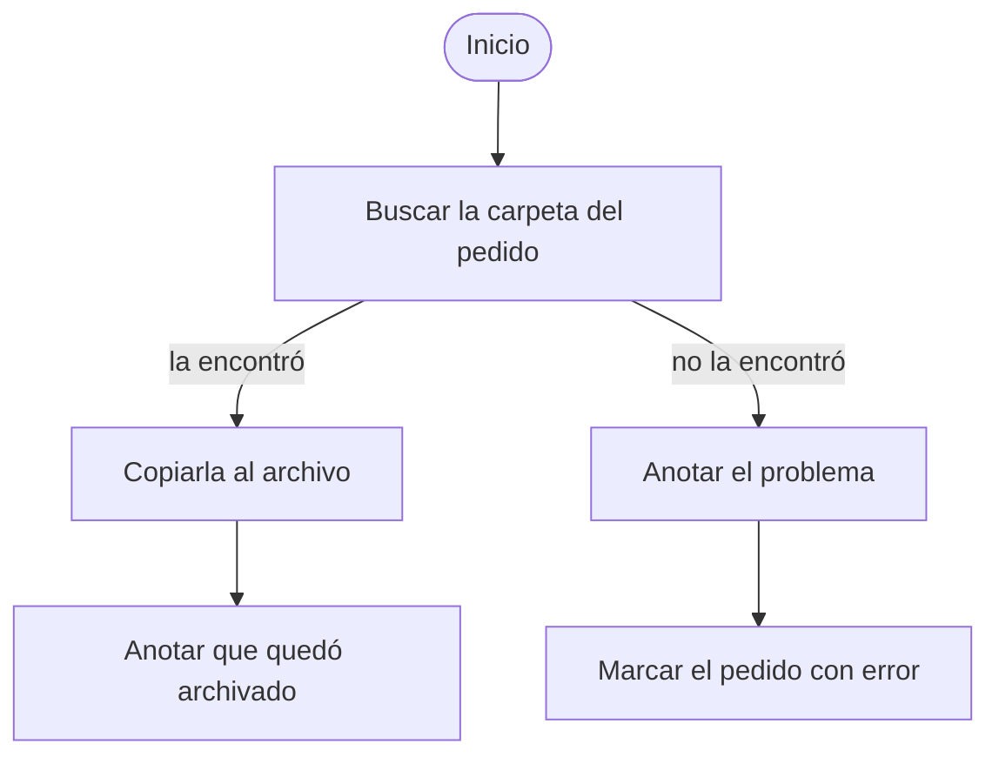
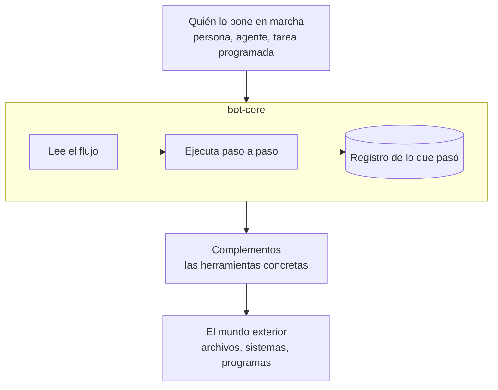
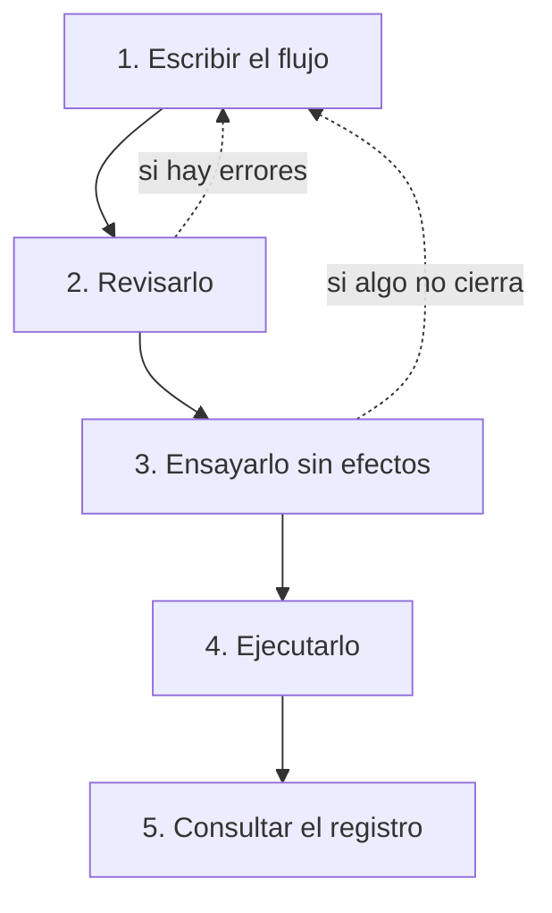
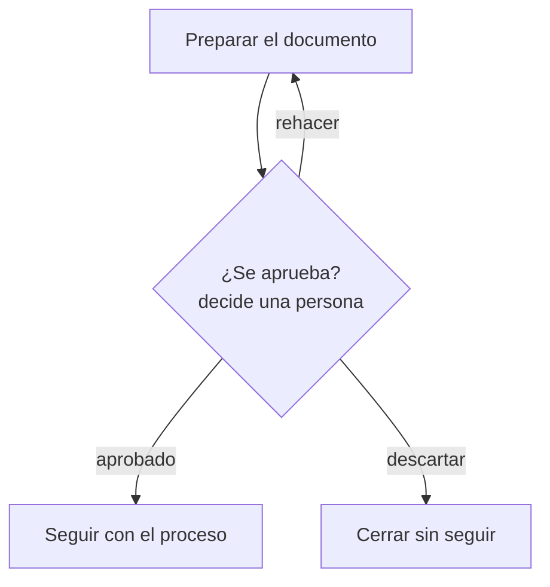
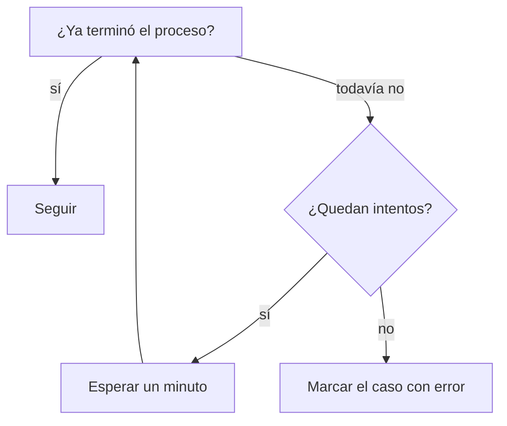
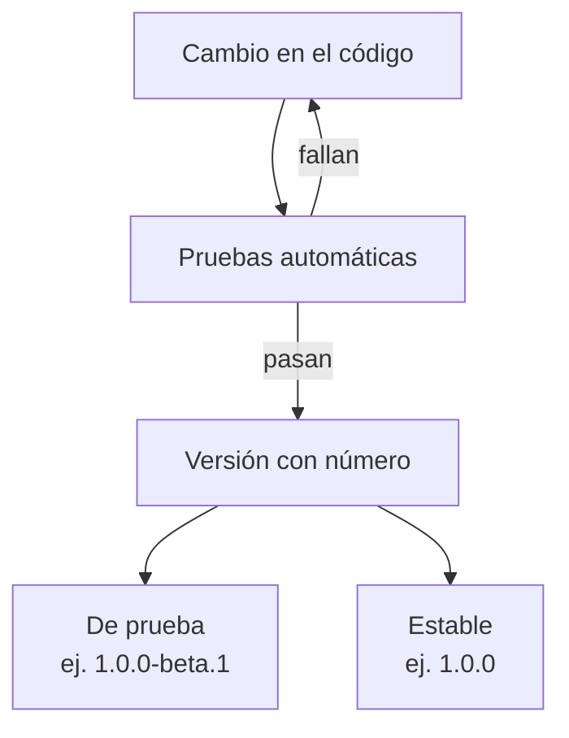

# bot-core: qué es y cómo se usa

Qué hace esta pieza de software, cómo se usa y qué controles trae, sin
entrar en detalles de programación. El detalle técnico está en `backend/README.md` y
`backend/docs/ARQUITECTURA.md`.

Este documento describe el software en sí, no un uso en particular. bot-core
no está pensado para una empresa ni para una industria concreta: lo que hace
en cada lugar depende de los flujos y los complementos que se le instalen.

## 1. En una frase

bot-core es un **motor que sigue procedimientos escritos como diagramas de
flujo, paso a paso, y deja anotado todo lo que hizo**.

## 2. Una comparación

Pensalo como una persona muy prolija que recibe un instructivo dibujado:

- Lee el diagrama y hace cada paso en el orden indicado.
- Si un paso sale bien, sigue por la flecha de "bien"; si sale mal, por la
  de "mal". Nunca improvisa un camino que no esté dibujado.
- Si el instructivo dice "acá decide una persona", se detiene y espera.
- Anota en un cuaderno qué hizo, cuándo, con qué datos y cómo le fue.

Esa persona no sabe hacer nada por sí misma: cada tarea concreta (copiar un
archivo, consultar un sistema, abrir un programa) la hace una herramienta que
alguien le tiene que haber dado. Esas herramientas son los **complementos**.

## 3. Qué es un flujo

Un flujo es un diagrama de pasos y flechas. Por ejemplo, un procedimiento
cualquiera para archivar un pedido:

El diagrama se escribe en un formato de texto estándar llamado **Mermaid**,
el mismo que usan muchas herramientas de documentación. Por eso el mismo
archivo sirve para leerlo como dibujo y para que el motor lo ejecute: lo que
se ve es exactamente lo que se ejecuta.

Cada vez que el motor recorre un flujo para un caso (un pedido, una fila de
una planilla, un archivo) se llama una **corrida**.

## 4. Las piezas

- **bot-core (el motor):** lee el flujo, decide cuál es el paso siguiente y
  deja el registro. No tiene pantallas propias: lo usa otro programa, o una
  persona desde una consola.
- **Complementos (plugins):** cada uno aporta tareas concretas. bot-core
  **no trae ninguno instalado**; cada organización instala los que necesita.
- **El mundo exterior:** todo lo que un complemento toca (archivos, otros
  sistemas, programas). Un complemento no accede a nada directamente: le
  pide al motor un acceso de un tipo declarado (red, archivos, programas,
  ventanas, etc.), y el motor decide si se lo da.

## 5. Cómo se usa, paso a paso

1. **Escribir el flujo.** Lo escribe una persona o un asistente de IA, con
   los pasos y las flechas.
2. **Revisarlo.** El motor controla el diagrama sin ejecutar nada: que cada
   paso use una herramienta que existe, que no falten datos y que las flechas
   tengan sentido. Si algo está mal, dice en qué paso y por qué.
3. **Ensayarlo sin efectos** (en inglés, *dry run*). El motor recorre el
   flujo con un caso de ejemplo pero **no hace** las tareas que modifican
   algo. Sirve para ver por qué camino iría. Solo se ejecutan las tareas que
   se declararon de solo lectura, y el motor impide que escriban.
4. **Ejecutarlo.** Ahora sí, para un caso real.
5. **Consultar el registro.** Se ve paso a paso qué hizo, con qué datos y
   cómo terminó.

## 6. Qué queda registrado

Cada corrida deja dos tipos de registro:

| Registro | Qué contiene | Para qué sirve |
|---|---|---|
| **Traza** | cada paso de una corrida, con los datos que usó, cómo terminó y el error si lo hubo | responder "¿qué pasó en esta corrida y por qué falló?" |
| **Bitácora** | líneas de texto por caso, a lo largo de todas sus corridas | responder "¿qué viene pasando con este caso?" |

Además, cada corrida guarda **quién la puso en marcha** (ver punto 8), cuándo
y con qué flujo.

Las contraseñas y otros datos secretos **nunca quedan en el registro**: el
motor los reemplaza por `***` antes de guardarlo. Cuánto tiempo se conserva
el registro lo configura cada instalación.

## 7. Cuando una persona tiene que decidir

Un flujo puede tener un punto en el que la decisión no la toma el motor sino
una persona. Ahí la corrida se detiene y espera:

- La corrida queda **en espera**, muestra las opciones posibles y una ayuda
  para quien decide.
- Mientras espera, el resto de los casos sigue funcionando.
- La espera sobrevive a un reinicio del equipo.
- Cuando la persona elige, el registro guarda **qué eligió y quién**.
- Si se edita el flujo mientras un caso espera, ese caso sigue con el flujo
  con el que empezó.

## 8. Quién puede hacer qué

Toda corrida queda a nombre de alguien, y según qué tipo de actor sea, el
motor le permite más o menos cosas:

| Actor | Ejemplo | Tareas peligrosas | Accesos |
|---|---|---|---|
| Persona | alguien del equipo | sí | todos |
| Agente | un asistente de IA | **no**, salvo que se habilite a propósito | solo red, archivos y reloj |
| Tarea programada | una corrida automática a cierta hora | sí | todos |
| Sistema | el propio programa | no | solo reloj |

Un complemento marca como **peligrosas** las tareas que borran o modifican
algo de forma importante. Si un flujo pide algo que su actor no tiene
permitido, **no arranca**, y el motor dice qué paso y qué regla lo impidió.

El motor registra la identidad que se le informa, pero no verifica
contraseñas: eso lo hace el programa que lo usa.

## 9. Cuando algo sale mal

- **Nada falla en silencio.** Si una tarea falla, el paso queda marcado con
  error y el detalle queda en la traza.
- El flujo puede tener un camino para el error (la flecha de "mal"). Si no lo
  tiene, la corrida termina con error.
- Si un flujo usa una herramienta que no está instalada, **no arranca**: no
  ejecuta la mitad del procedimiento para descubrir el problema después.
- Los reintentos ("probá de nuevo en un minuto, hasta 5 veces") se dibujan en
  el flujo, así que quedan a la vista y tienen un límite.

## 10. Límites y controles que trae

- **Carpetas permitidas.** Cada instalación declara en qué carpetas se puede
  leer y escribir. Fuera de ellas, el acceso se niega. Las carpetas propias
  del motor (su base de datos y su configuración) quedan siempre protegidas.
- **Programas permitidos.** Cada instalación puede limitar qué programas se
  pueden ejecutar desde un flujo.
- **Accesos declarados.** Cada complemento declara de antemano a qué accede
  (red, archivos, programas, ventanas...). Si usa algo que no declaró, falla.
  Así se puede ver la lista de lo que cada complemento puede tocar.
- **Secretos protegidos.** Las contraseñas y claves se guardan cifradas, no
  se muestran nunca en pantalla y no quedan en el registro.
- **Configuración revisada al arrancar.** Si un límite de seguridad está mal
  configurado (por ejemplo, una carpeta que no existe), el motor no arranca a
  medias: avisa y se detiene.

## 11. Qué no hace

- No tiene pantallas ni interfaz propia: se usa desde otro programa o desde
  una consola.
- No trae integraciones con ningún sistema: vienen todas de complementos que
  se instalan aparte.
- No toma decisiones por su cuenta: elige el camino solo según el resultado
  de cada paso y lo que dice el flujo, o lo que elija una persona.
- No usa inteligencia artificial para ejecutar ni para decidir. Un asistente
  de IA puede *escribir* flujos, pero lo que se ejecuta es el diagrama
  escrito, y el asistente corre con permisos restringidos.
- No accede a carpetas, programas ni servicios que la instalación no haya
  habilitado.
- No tiene ninguna finalidad específica de una industria: es una herramienta
  general para automatizar procedimientos.

## 12. Cómo se publican las versiones

- Cada versión tiene un **número único** (por ejemplo `1.0.0`), así que
  siempre se puede saber qué versión está instalada y qué cambió entre una y
  otra.
- Antes de publicar una versión se corre automáticamente el conjunto completo
  de pruebas (cientos de casos). Si alguna falla, la versión no se publica.
- Las versiones **de prueba** (con `-beta` o `-rc` en el número) sirven para
  probar novedades. Las **estables** (sin sufijo) son las que se recomiendan
  para uso normal.
- El código es abierto y cada cambio queda registrado en el historial del
  repositorio, con fecha y descripción.

## 13. Para quien lo evalúa en una organización

Estos son los hechos sobre bot-core que sirven para evaluarlo:

- Es una **herramienta general**: no tiene finalidad médica, contable ni de
  ningún rubro en particular. No contiene lógica de ningún negocio.
- Su comportamiento concreto lo definen **los flujos y los complementos que
  instala cada organización**. Por eso, el análisis de riesgo y las pruebas de
  aceptación corresponden a ese uso concreto (qué flujos, qué complementos,
  sobre qué datos), no al motor por separado.
- Para ese análisis, el motor ofrece:
  - versiones identificables y publicadas con pruebas automáticas;
  - registro de cada corrida, paso por paso, atribuido a quién la inició;
  - registro de quién tomó cada decisión manual y qué eligió;
  - revisión y ensayo de un flujo antes de ejecutarlo;
  - permisos por tipo de actor y límites de carpetas y programas;
  - fallas visibles: nada falla en silencio y un flujo mal armado no arranca;
  - secretos cifrados y tapados en el registro.
- La conservación del registro (cuánto tiempo, cuántas líneas por caso) es
  configurable. Si una organización necesita conservarlo por un plazo
  determinado, lo tiene que configurar así.

## 14. Glosario

| Término | Qué significa |
|---|---|
| Flujo | Un procedimiento dibujado como diagrama de pasos y flechas. |
| Corrida | Una vez que el motor recorre un flujo para un caso. |
| Caso | Aquello sobre lo que trabaja una corrida: un pedido, una fila, un archivo. |
| Paso (nodo) | Una caja del diagrama: una tarea o una decisión. |
| Complemento (plugin) | Un paquete que agrega herramientas concretas al motor. |
| Herramienta (tool) | Una tarea concreta que puede hacer un paso, aportada por un complemento. |
| Actor | Quién pone en marcha una corrida: persona, agente, tarea programada o sistema. |
| Traza | El registro paso a paso de una corrida. |
| Bitácora (log) | Las líneas de texto acumuladas sobre un caso. |
| Ensayo sin efectos (dry run) | Recorrer un flujo sin hacer las tareas que modifican algo. |
| Decisión manual | Un punto del flujo donde una persona elige el camino. |
| Mermaid | Formato de texto estándar para escribir diagramas. |
